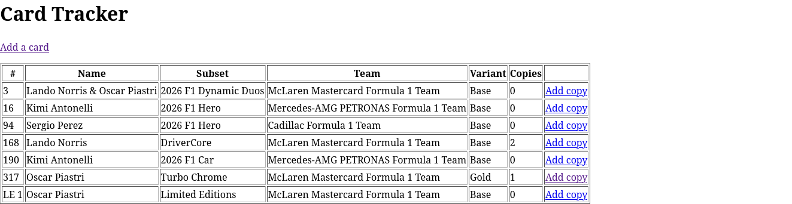
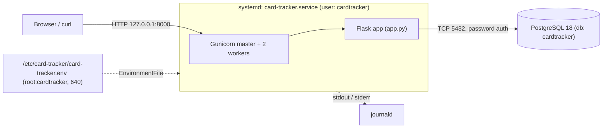

# F1 Card Collection Tracker

A web app for tracking my Topps F1 Turbo Attax card collection: the full set checklist,
the physical copies I own, and which cards I'm still missing. Built with Python, Flask
and PostgreSQL, and deployed on Ubuntu as a hardened systemd service.

I built this as a hands-on project to practise Linux administration, service deployment
and troubleshooting alongside application development. It runs in my own lab environment
(an Ubuntu VM) and is not a production system.

**Status:** in progress. See the [roadmap](#roadmap).



## Features

- Master checklist of cards per set, including numbered parallels (e.g. Gold /50)
- Record individual physical copies: condition, serial number, storage location, price, date
- Copy counts per card, including cards I don't own yet (0 copies)
- Server-side validation on every form, with clear error messages
- `/health` endpoint that checks database connectivity (200 or 503)


## Tech stack

| Area | Tools |
|---|---|
| Application | Python 3.14, Flask 3.1, Jinja2 templates |
| Database | PostgreSQL 18, psycopg 3 |
| Server | Gunicorn (2 workers), systemd |
| OS | Ubuntu 26.04 LTS (ARM VM) |
| Testing | pytest, curl |

## Architecture



### Database design


- **`sets`**: one row per release (year + name), so future sets fit without changes.
- **`cards`**: the master checklist. Each variant (Base, Gold /50, etc.) is its own row,
  enforced by `UNIQUE (set_id, card_number, variant)`.
- **`owned_copies`**: one row per physical card, so duplicates can each have their own
  condition, serial number and price.

Key decisions:
- Foreign keys use `ON DELETE RESTRICT`, so a checklist card can't be deleted while copies exist.
- `CHECK` constraints reject invalid values at the database level (e.g. negative prices, print run 0).
- "Serial number ≤ print run" compares two tables, which a `CHECK` can't do, so it's validated in Python.
- Money is stored as `NUMERIC(8,2)` and handled as `Decimal` in Python, never as floats.
- Schema changes are numbered migration files in `db/`, each run once in a single transaction.

## Security

- **Least privilege:** the app connects as a dedicated PostgreSQL role that owns only its own
  database (not a superuser), and runs as a dedicated Linux system user with no login shell.
- **Credentials kept out of Git:** connection settings come from environment variables.
  Locally: `.env` (git-ignored, `chmod 600`). Deployed: `/etc/card-tracker/card-tracker.env`
  (`root:cardtracker`, `640`).
- **SQL injection:** all queries are parameterised; user input is never inserted into SQL text.
- **XSS:** Jinja2 escapes all output automatically.
- **Error details** are written to the logs, not returned in HTTP responses.
- **systemd hardening:** `NoNewPrivileges`, `ProtectSystem=strict`, `ProtectHome`, `PrivateTmp`.
  Unused Gunicorn control socket disabled.

## Testing

**Automated (pytest):** 16 tests covering validation rules (including the 50/50 serial
number edge case and invalid prices like `nan` and `Infinity`) and `/health` returning 503
during a simulated database outage. I confirmed the tests catch bugs by deliberately
breaking a comparison (`>` to `>=`) and checking the edge-case test failed.

```bash
pytest -v
```

**Manual (curl), bypassing browser-side checks:**

| Request | Expected | Result |
|---|---|---|
| Add card with empty number and print run 0 | 400, both errors listed | 400 |
| Serial number on an unnumbered card | 400 | 400 |
| Invalid price and a future date | 400 | 400 |
| Add copy for a card that doesn't exist | 404 | 404 |
| Serial 51 on a /50 card | 400 | 400 |
| Team name not on the allowed list | 400 | 400 |

**What different failures look like**, from my testing:

| Observed | Meaning |
|---|---|
| curl `000`, exit code 7 | Nothing listening: the app isn't running |
| `500` | App running, but crashed (e.g. missing database settings) |
| `503` from `/health` | App running, database unreachable |
| `400` / `404` | App working, request rejected |

## Troubleshooting and incidents

- [Incident 001: database stopped](docs/incidents/001-database-stopped.md), a controlled test:
  symptoms, log investigation, root cause, fix and verification.
- The [project log](docs/project-log.md) records every step, including real problems found
  along the way: an unplanned OS upgrade leaving an old PostgreSQL cluster behind,
  inconsistent data from free-text fields, and a Gunicorn permission error at startup.

## Setup (development)

Requires Ubuntu with PostgreSQL, Python 3 and Git.

```bash
sudo apt install postgresql python3-venv git

# Database role and database
sudo -u postgres createuser --pwprompt cardtracker
sudo -u postgres createdb --owner cardtracker cardtracker

# Code and Python environment
git clone https://github.com/LFBliham/card-tracker.git
cd card-tracker
python3 -m venv .venv
source .venv/bin/activate
pip install -r requirements.txt -r requirements-dev.txt

# Configuration: set your own password in .env
cp .env.example .env
chmod 600 .env

# Create the tables (migrations, in order) and the first set
set -a; source .env; set +a
for f in db/*.sql; do psql -v ON_ERROR_STOP=1 -1 -f "$f"; done
psql -c "INSERT INTO sets (year, name) VALUES (2026, 'Topps F1 Turbo Attax');"

# Run
flask --app app run --debug     # http://127.0.0.1:5000
pytest -v
```

## Deployment

Deployed with Gunicorn under systemd. Summary (full details in the [project log](docs/project-log.md)):

- System user `cardtracker` (`--system`, no home, `nologin` shell)
- Code cloned to `/opt/card-tracker` (root-owned, read-only to the service), with its own venv
- Config in `/etc/card-tracker/card-tracker.env` (`root:cardtracker`, `640`)
- Unit file: [`deploy/card-tracker.service`](deploy/card-tracker.service)
  (`Restart=on-failure`, enabled at boot)
- Verified after `sudo reboot`: both services active and `/` returning 200 with no manual steps

Updating the running service:

```bash
sudo git -C /opt/card-tracker pull
sudo systemctl restart card-tracker
curl -i http://127.0.0.1:8000/health
```

Logs:

```bash
journalctl -u card-tracker -f                                        # follow live
journalctl -u card-tracker --since "1 hour ago" -g "Traceback|ERROR" # search
```

## Roadmap

- [x] PostgreSQL schema with constraints and migrations
- [x] Add cards and owned copies with server-side validation
- [x] systemd deployment under a dedicated user
- [x] `/health` endpoint
- [x] Automated tests (pytest)
- [x] Incident report: database outage
- [ ] Monitoring script on a schedule (systemd timer) recording response times and failures
- [ ] Automated PostgreSQL backups with retention, plus a tested restore
- [ ] More incident reports: misconfiguration, file permission problem
- [ ] Edit/delete cards, search and filter, completion percentage per set
- [ ] Import the full checklist from CSV
- [ ] Move subsets and teams into database tables linked to each set
- [ ] Deploy to a separate Ubuntu machine managed over SSH
- [ ] Run tests automatically on every push (GitHub Actions)
